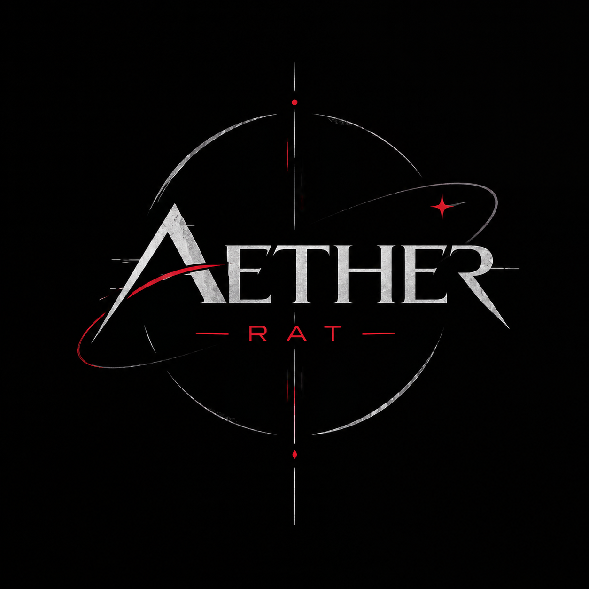

                 Aether RAT

  

  <strong>Windows Remote Administration & Security Research</strong>

  
  
  

---

Hakkında

Aether RAT, Windows platformuna yönelik, eğitim ve yetkilendirilmiş güvenlik araştırmaları amacıyla geliştirilen deneysel bir uzaktan yönetim projesidir.

Proje henüz geliştirme aşamasındadır. Teknik ayrıntılar, dokümantasyon ve geliştirme sürecine ilişkin güncellemeler ilerleyen aşamalarda paylaşılacaktır.

Geliştirme Durumu

Bileşen| Durum
Görsel kimlik ve logo| Tamamlandı
Temel geliştirme| Planlanıyor
Dokümantasyon| Planlanıyor
Test süreçleri| Planlanıyor

Projenin Amacı

- Windows sistemlerinin uzaktan yönetim mimarisini incelemek
- Güvenlik araştırmaları için teknik deneyim kazanmak
- Kontrollü ve izinli test ortamlarında çalışma yapmak

Sorumluluk Bildirimi

Bu proje eğitim ve yetkilendirilmiş güvenlik araştırmaları için tasarlanmaktadır. İzinsiz erişim, gözetim veya başkalarının verilerinin ele geçirilmesi amacıyla kullanılmamalıdır.

Geliştirme

Proje geliştikçe yeni bilgiler ve teknik belgeler bu depo üzerinden paylaşılacaktır.

---

  <i>Aether RAT — Geliştirme devam ediyor.</i>

