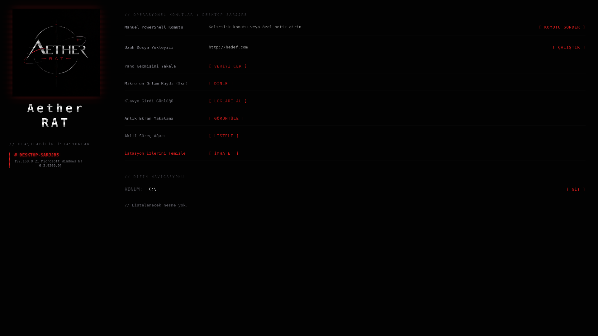

*Aether RAT*

<p align="center">
  
</p><p align="center">
  <strong>Windows Remote Administration & Security Research</strong>
</p><p align="center">
  
  
  
</p>---

## Hakkında



Aether RAT, Windows platformuna yönelik, eğitim ve yetkilendirilmiş güvenlik araştırmaları amacıyla geliştirilen deneysel bir uzaktan yönetim projesidir.

Proje henüz geliştirme aşamasındadır. Teknik ayrıntılar, dokümantasyon ve geliştirme sürecine ilişkin güncellemeler ilerleyen aşamalarda paylaşılacaktır.


## Geliştirme Durumu

Bileşen | Görsel kimlik ve logo | Tamamlandı

Temel geliştirme | Tamamlandı

Dokümantasyon | Tamamlandı

Test süreçleri | Planlanıyor


## Özellikler

- 5 saniye ortam dinlemek (TEST EDİLMEDİ)
- Anlık ekran görüntüsü
- Pano geçmişini görüntüle
- Klavye girdi günlüğü
- Anlık süreç ağacı
- Kendisini silmek
- Dışardan harici dosyalar indirmek (TEST EDİLMEDİ)
- Dosya yöneticisi
- Özel komut girmek (Örn. programı yeniden başlatmalara eklemek vb.)

## Kurulum

```bash
git clone https://github.com/drhakoo-beep/Aether-RAT

cd Aether-RAT

python -m venv venv

source venv/bin/activate

pip install fastapi uvicorn jinja2 --break-system-packages
```

Daha sonra

```bash
nano program.cs
```

Komutundan sonra kod içindeki "SİZİN_İP_ADRESİNİZ" yazan yere IP adresinizi yazın. (Örn: 192.168.0.16)

## Çalıştırma

```bash
python main.py
```

Şimdi tarayıcınızdan localhost:8080 adresine gidiniz.

Panel açıldıktan sonra, program.cs dosyanızı .exe formatında derleyiniz. 


(Windows) içinde derleme komutu;

```bash
C:\Windows\Microsoft.NET\Framework64\v4.0.30319\csc.exe /target:winexe /r:System.Drawing.dll,System.Windows.Forms.dll program.cs
```

(Linux) içinde derleme komutu;

```bash
sudo apt install mono-complete -y

cd /dosyanin/oldugu/dizin

mcs -target:winexe -r:System.Drawing.dll,System.Windows.Forms.dll program.cs
```

Derlendikten sonra sanal makinanıza veya izinli olduğunuz cihazlara flaşbellek vb. yöntemlerle indirin, .exe programına çift tıklayın ve artık hazırsınız.

Panelde sayfayı yenileyin ve cihaz isminin göründüğünü görebilirsiniz, üstüne tıklayın.

-Tebrikler! Artık hazırsınız

## Projenin Amacı

- Windows sistemlerinin uzaktan yönetim mimarisini incelemek
- Güvenlik araştırmaları için teknik deneyim kazanmak
- Kontrollü ve izinli test ortamlarında çalışma yapmak


## Sorumluluk Bildirimi

Bu proje eğitim ve yetkilendirilmiş güvenlik araştırmaları için tasarlanmaktadır. İzinsiz erişim, gözetim veya başkalarının verilerinin ele geçirilmesi amacıyla kullanılmamalıdır. Programda başlatmalara ekleme, kalıcılık yöntemleri, antivirüs yazılımlarını atlatma gibi amaçlar bulunmamaktadır, tüm sorumluluk kullanan kullanıcıya aittir.


*Geliştirme*

Proje geliştikçe yeni bilgiler ve teknik belgeler bu depo üzerinden paylaşılacaktır.

23 Ekim -> Temel C# kodu hazırlandı, web arayüzü tamamlanıyor.

24 Ekim -> İlk sürüm yayınlandı.
---

<p align="center">
  <i>Aether RAT — Geliştirme devam ediyor.</i>
</p>
